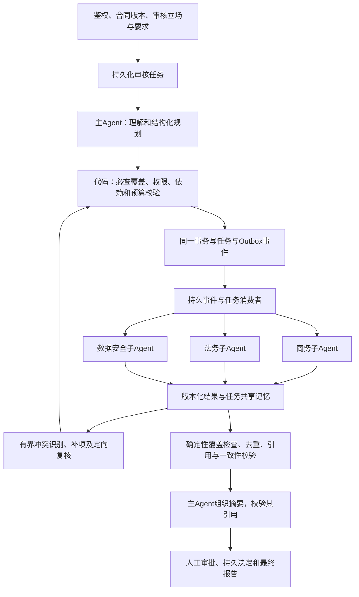

# 25｜合同审核主从Agent、共享记忆与事件驱动改造执行计划

日期：2026-10-24。用途：交给DeepSeek执行的工程任务书。

**当前状态：仅完成计划与源码核对；本计划全部新增实现、测试和真实验收均未执行。** 不沿用历史285项通过记录作为本次新增能力的验收证据。

## 1. 目标与范围

将现有固定三分支合同预审扩展为：**主Agent受约束理解与规划→确定性任务校验→专业子Agent执行→任务级共享记忆→事件触发有限协同复核→结构化汇总、引用核验及人工审批**。

必须能演示不同合同类型、审核立场和专项要求带来的任务差异；不能只是把固定工作流三个节点换名。必须能演示跨进程任务执行、失败恢复与重复事件处理；不能把普通LangGraph边或进程内回调称为持久化事件系统。

本次实施只改合同项目及必要文档，不改问数、RAG、销售助手和底座路由，不切换生产。不新增云端模型、不预先微调、不加入任意Agent自由互聊或外部自主操作。保持现有合同类型范围，未批准类型转人工；不借此宣称通用法律能力。原件/Ceph、完整OCR、长合同切分等已有缺口不因本次改造被标记完成。

代码仓库：`D:\projects\railguard-contract-review`。
统一记录目录：`D:\projects\小佩\文档`。
仓库镜像计划建议位置：`docs/supervisor-agent-plan-20261024.md`。

## 2. 已核对的现有实现

| 位置 | 当前能力 | 改造原则 |
|---|---|---|
| `src/railguard/workflow/graph.py` | 初始化、证据检索、商务/法务/安全三分支、汇合、引用核验、人工审批 | 保留`fixed_v1`作为行为对照，新增`supervisor_v2`，不原地抹掉基线 |
| `workflow/state.py` | `ReviewState`、独立三类findings、add归并轨迹/错误/耗时 | 增加版本化规划/执行摘要，避免把无界完整记录塞入图状态 |
| `workflow/nodes.py` | 专业审核、汇总、引用校验、人工中断 | 复用专业分析和证据校验，调整为任务输入和有界局部上下文 |
| `workflow/service.py` | 审核启动、查询、人工恢复、旧节点进度 | 接持久任务、版本、取消和新进度；不能继续固定节点百分比冒充动态任务进度 |
| `workflow/checkpoint.py`、`workflow/postgres.py` | 安全序列化白名单、生产PG检查点 | 增加新类型/版本兼容；不开放pickle |
| `agents/llm.py`、`agents/models.py`、`agents/prompts.py` | 三类专业结构化输出与职责校验 | 复用并引入任务级约束，主Agent独立Schema及提示词 |
| `agents/provider.py`、`api/main.py` | 模型适配与生产入口 | 继续走底座`local-chat`，真实权重revision显式记录 |
| `storage/`、`workflow/decisions.py` | 业务持久化、权限、审批幂等恢复 | 扩展时保留对象授权、跨进程锁、pending/applied语义 |
| `tests/`、`evaluation/` | 已有回归与风险评估设施 | 保留并增量扩展，执行前先记录当前基线 |

执行者先查阅目录及AGENTS.md，确认实际接口、历史未提交改动和现有迁移工具。上述新文件名只是建议，不假设尚不存在的函数已经实现。

## 3. 目标架构与责任边界



主Agent负责理解、建议任务与协同、组织摘要；**实际执行权限、必查项、调度、依赖解锁、预算和批准状态由代码控制**。主Agent不得直接执行SQL、动态导入代码、新建任意Agent、覆盖授权或自行批准合同。

子Agent只执行注册专业范围内的任务；可报告缺失证据、疑似冲突或建议下一步，但不能直接派生任务或消费其他合同记忆。真实模型可共用同一27B服务；多Agent不代表多模型，也不等于提供模型故障高可用。

主Agent的规划可用全合同结构与受控摘要；长文超预算时明确拒绝/转人工，不静默截断。子任务传递引用和必要条款，不给每个Agent复制全部历史及无界对话。

## 4. 明确的契约

统一采用严格Pydantic模型，禁止任意额外字段；持久化JSON含`schema_version`。内部标识由可信服务生成，不接受模型指定tenant、主体、权限、审批者或可信事件ID。

### 4.1 审核上下文与计划

`ReviewContext`：tenant、review_id、contract_id、contract_version/hash、审核立场、合同类型、业务规则版本、允许专业、权限快照/版本、模型revision与工作流版本。权限快照仅用于追踪，每次领取/读取/提交仍须复查当前授权。

`ReviewPlan`：plan_id/version、结构化任务、覆盖矩阵、待澄清事项及假设。每项必查要求映射到任务，或有可解释且经规则允许的不适用记录；主Agent不能以“未发现风险”跳过检查。计划变更增版本，不覆盖历史。

`ReviewTask`：task_id、plan_version、专业枚举、objective、clause_ids、evidence_ids、required_check_ids、depends_on、round、输入指纹、状态、attempt、lease_owner/until、fencing_token、deadline、输出引用。任务依赖必须是同一审核版本内的有向无环图。

示例，仅为输入契约，不是已实现接口：

```json
{
  "task_id": "task_001",
  "plan_version": 1,
  "specialist": "commercial",
  "objective": "核对付款触发条件与验收条款的一致性",
  "clause_ids": ["clause_12", "clause_18"],
  "evidence_ids": ["evidence_03"],
  "required_check_ids": ["payment_trigger", "acceptance_condition"],
  "depends_on": [],
  "round": 0
}
```

模型计划仅允许引用当前上下文中可见的条款、证据和专业。越界引用、未知专业、循环依赖、重复任务、漏必查项、超预算均应被校验拒绝或修正规划；有限修复失败后标记待人工，不静默退回成功。

### 4.2 子任务结果与冲突

`TaskResult`：task_id、attempt/fencing_token、输入与合同版本、`completed/needs_clarification/failed`、checked_requirement_ids、风险候选、原文位置与证据ID、未解决问题、结构化冲突候选、模型revision、token/耗时元数据。

风险候选必须有稳定ID及任务来源；“无风险”也必须明确记录已检查哪些要求。未知引用、角色越权分类或旧版本结果不纳入当前结论。禁止只靠模型自报置信度决定风险有效性。

`ConflictRecord`：涉及任务/风险/条款、冲突类型、可核查事实、复核目标、状态和解决记录。保留原始专业判断；复核输出通过supersedes关系表达修订，不删除不利结论或用多数投票当真值。

确定性代码发现显式矛盾/漏项，主Agent可提出需进一步验证的跨条款冲突；只有受控调度器创建复核任务。每个冲突用规范指纹去重，最多一轮复核，循环建议记录为未解决并转人工。

### 4.3 共享记忆

本期只做**单审核任务、单合同版本内的结构化共享记忆**。PG任务/结果/冲突表为业务权威，图状态保存引用、版本和有界摘要。共享记忆不是全员可改的共享长字符串，也不是新建跨合同向量知识库。

建议`MemoryRecord`包含scope、kind、producer、source_task、contract/plan version、内容hash、条款与证据来源、created_at、状态及supersedes。区分原文事实、检索证据、模型判断、待解决问题及人工决定；角色写权限由代码限定。敏感正文默认不进入审计日志。

合同改版建立新审核快照，使旧规划、结果、摘要和待处理事件显式过期；不得悄悄复用旧结论。原件未变时任务版本也必须绑定规则与模型版本。跨合同经验学习留后续，需独立批准和数据治理。

### 4.4 事件与一致性

首期使用现有PG完成**Transactional Outbox＋任务表＋消费收件箱/处理记录**，轮询worker即可，不为标签引入Kafka/RabbitMQ。至少支持API与worker分进程、worker多副本执行。

事件信封：可信event_id、event_type、schema_version、tenant、review_id、contract_version、plan_version、task_id（适用时）、aggregate_sequence、correlation_id、causation_id、occurred_at、payload引用与hash。事件是事实通知，不传无界合同全文。

事件至少覆盖`review.requested`、`plan.validated`、`task.ready`、`task.completed`、`task.failed`、`conflict.detected`、`review.ready_for_human`、`human.decision_applied`、`review.cancelled`。先明确每种事件的生产者、消费者、允许状态迁移及副作用。

关键写入：任务完成状态、结果、记忆更新、对应outbox事件必须在**同一业务数据库事务**中提交。消费者依赖数据库当前任务状态和版本检查，不依赖事件到达顺序或“发了几条完成消息”。每消费者对event_id幂等；outbox发布/消费是至少一次语义。

领取任务用行锁/`SKIP LOCKED`、租约与fencing token；提交结果须匹配当前attempt、租约、版本和授权。超时回收后旧worker返回不得覆盖新结果。失败设有界重试/下次可用时间，永久失败入隔离记录，不造成无限热循环。

**不承诺模型调用exactly-once**：模型可能已生成但结果未提交，需保留attempt和结果不确定状态；仅对明确可重试错误使用预算内策略，幂等的是业务提交。开始输出或结果不确定时不盲目自动重放。

业务PG与LangGraph checkpoint分开管理时不假装拥有跨库原子事务：以业务任务/版本为权威，图在恢复时读取、核对已提交任务，并通过幂等命令前进。检查点不与事件消费者同时各自派发同一任务。明确唯一协调者，保留现有审批pending/applied恢复机制。

## 5. 状态、安全与预算

建议状态：审核`queued/planning/running/needs_attention/awaiting_human/completed/failed/cancelled`；专业任务`pending/ready/running/completed/needs_clarification/failed/cancelled`。现有对外ReviewStatus可能有不同枚举，必须制定版本化映射，不直接破坏旧客户端。

只有必查项均完成或有规则允许的不适用记录、引用校验通过、未解决问题明确披露，才进入人工审核。必查任务失败不得生成“审核通过”或“无风险”；允许展示显式标注未完成的部分报告，不能把它等价于完整审核。

对象权限覆盖计划、任务、记忆、事件、检查点恢复、结果与审批；内部worker身份不意味着可越tenant读取。合同和检索内容当作不可信输入，不能指挥主Agent更换专业、外发数据、解除预算或跳过人工。

第一版可配置初始护栏：初始任务最多12个、累计任务24个、协同复核1轮、单review并发3、单任务attempt最多2、全部LLM尝试累计最多30次；总token/时限另配且必填。数值为**工程初值，不是生产容量承诺**。所有主Agent规划/修复/汇总调用和子Agent重试都计入预算。

预算预留必须跨worker原子化，失败/取消归还未使用预留；已执行或不确定的模型调用不能假装未消耗。截止时间/取消阻止新任务与新提交，取消尽力终止在途调用并记录状态，不宣称已经退费或绝无上游计算。

继续仅调用批准内网`local-chat`，合同故障不回退到云；真实revision接通后固定登记。模型备用/熔断属于另一个底座可靠性任务，本计划不把它当已完成。

## 6. 分阶段实施清单

所有框默认未完成。执行者每完成一项须填写代码位置、测试命令、报告路径、限制；不能只把框打勾。

### 阶段A：基线、契约和开关（预计1–2工作日）

- [ ] A1 核对现有改动和适用指令，保存fixed_v1实际测试基线及报告，禁止覆盖他人未提交修改。
- [ ] A2 定义审核上下文、计划/任务/结果/冲突/事件Schema及必查规则表；首批类型与立场从既有配置取，不编造法务批准。
- [ ] A3 引入服务端`REVIEW_ORCHESTRATION_MODE=fixed_v1|supervisor_v2`，默认fixed_v1；路由选择及模式随审核任务固定，客户端不得任意更改。
- [ ] A4 增量迁移设计、状态映射、序列化白名单、旧checkpoint/旧审批兼容说明。生产保持PG，SQLite最多用于显式本地单进程验证。

验收：契约边界/非法输入测试、旧模式回归通过；新增模式尚不可用必须显式返回，不伪装成旧模式成功。

### 阶段B：持久任务、Outbox与共享记忆（预计2–3工作日）

- [ ] B1 实现PG增量迁移、索引、唯一约束、对象授权与版本约束；迁移角色与运行角色分离。
- [ ] B2 实现审核启动持久化，任务/结果/记忆/outbox原子提交，事件消费去重及死信/隔离；明确权威状态与图恢复协议。
- [ ] B3 实现任务领取、租约、续租、fencing、依赖解锁、预算预留、取消与超时回收，至少两个worker可运行。
- [ ] B4 实现任务级记忆读写接口、来源与修订追踪、版本失效及大小限制；不引入无界聊天历史。
- [ ] B5 验证API提交后即使API退出，worker仍能继续；worker崩溃/重启后按实际状态恢复，旧worker迟到结果被拒绝。

验收：真实隔离PG完成多进程、重复/乱序事件、事务失败与租约恢复；纯内存fake通过不够。

### 阶段C：主Agent与任务级专业执行（预计2–3工作日）

- [ ] C1 主Agent规划提示词和严格输出Schema，LLM经现有provider接入；测试替身与真实模式明确分开。
- [ ] C2 代码实现必查覆盖校验、任务DAG/专业/引用/版本检查；计划仅可有限修复，失败转待人工。
- [ ] C3 将既有三类专业analyzer包装成任务执行器，任务限定输入、职责范围、检查结果、风险引用及失败状态。
- [ ] C4 API启动异步返回、查询展示阶段/完成任务/未完成任务/当前版本。supervisor_v2新增异步契约不破坏fixed_v1旧契约，路由及返回码写文档。
- [ ] C5 动态进度来自已提交的任务执行状态；规划变动显示分母变化，不声称固定50%节点等于真实完成比例。

验收：三种已支持的合同/立场/专项组合产生可解释的不同任务，必查覆盖完整；越界工具/未知专业、注入和缺证据均受控。

### 阶段D：有限协同复核与最终审核（预计2–3工作日）

- [ ] D1 实现冲突候选结构、确定性校验、冲突指纹去重和事件触发复核；测试付款/验收/解除退款跨条款问题。
- [ ] D2 主Agent只提出受约束补项，调度器决定是否创建任务；执行轮次、累计任务及预算上限，未解决冲突转人工。
- [ ] D3 确定性合并、风险稳定ID、引用核验、任务覆盖与完成性检查；保留不同意见和修订血缘。
- [ ] D4 主Agent汇总只依据有效任务结果，验证每条风险/证据引用，禁止新增无依据的风险或删除未解决项。
- [ ] D5 复用人工审批、授权复查、pending/applied恢复与最终决定；用户/法务决定不被后续迟到事件覆盖。

验收：一次事件触发定向复核、复核有界、原结果可追踪；一个Agent失败时部分报告明确未完成，不能显示全合同通过。

### 阶段E：完整回归、对照与交接（预计2–3工作日）

- [ ] E1 跑旧全量回归及新增集成测试，修复新旧状态、监控摘要、序列化与审批恢复兼容。
- [ ] E2 构建冻结合成评测和故障序列，跑fixed_v1/supervisor_v2同输入、同规则、同模型revision对照；能力未接通时不填真实收益数字。
- [ ] E3 提供启动/worker/迁移/恢复/取消/回滚说明、演示脚本、观测指标与故障演练记录。
- [ ] E4 统一交付记录：已完成/未完成、代码路径、测试命令/数量/报告、真实服务与替身边界、后续企业输入；更新18号总结及19号索引。

顺序：A→B→C→D→E，B的持久化一致性不可被“先让Agent跑起来”跳过。预计单人约**11–17个工作日**，是规划量级，真实环境、复杂回归和需求变化会影响时间；不要承诺几个小时生产完成。

## 7. 必须覆盖的验收场景

| 编号 | 场景 | 必须结果 |
|---|---|---|
| T01 | 主Agent漏必查项/未知专业/越界引用/循环依赖 | 校验阻止执行；有限修复或待人工 |
| T02 | 同任务多个条款、跨条款引用、未定义条件 | 来源准确；信息不足明确披露 |
| T03 | 三专业并行写结果及公共记忆 | 无互相覆盖，结果可追踪且正确归属 |
| T04 | 同事件重复、顺序颠倒、旧计划事件晚到 | 不重复业务结果、不推进错误版本 |
| T05 | 模型已调用但结果事务提交失败 | 记录不确定attempt，恢复遵守重试预算，不声称exactly-once调用 |
| T06 | 任务结果提交后、事件消费前worker退出 | 结果保留，重放幂等推进，事务内无半份记忆 |
| T07 | 旧worker租约过期、新worker接管、旧结果返回 | fencing阻止旧结果写入 |
| T08 | 并发派发抢预算/重复依赖解锁 | 不超预算、不重复创建同一任务 |
| T09 | 一个专业超时/失败，其他专业完成 | 显式未完成/待人工，绝不“无风险通过” |
| T10 | 重复冲突、循环复核建议、达到上限 | 最多一轮复核，剩余争议披露并转人工 |
| T11 | 取消、截止、在途撤权、跨tenant/review记忆读取 | 阻止新执行/提交及越权读取，保留审计 |
| T12 | 合同改版、规则版本变更、旧检查点恢复 | 禁止旧结论污染新版本，不自动批准 |
| T13 | 主Agent汇总编造风险/引用或忽略失败 | 输出校验拒绝或报告降级为未完成 |
| T14 | 人工审批并发/重放、checkpoint与业务确认不同步 | 延续现有幂等恢复，不重复应用决定 |
| T15 | 原fixed_v1审核、权限、审批及旧checkpoint | 兼容；无法兼容给出可操作迁移方案 |
| T16 | 权限/任务/事件敏感信息与提示注入 | 无模型越权、无外发、日志无合同全文或密钥 |

并发和崩溃测试通过进程边界、数据库记录与故障注入证明，避免只写模拟函数调用次数的测试。新增异步API正常/异常/幂等流程都要集成测试。

## 8. 合成评测与效果判断

首版建议60个合成样本，分开发20/冻结留出40，按合同结构、条款冲突族划分，不能仅替换名称/日期。覆盖三专业单项风险、跨专业冲突、缺条款、无风险但已检查、证据不足、合同注入与版本变更。合成风险标签是工程约定，需要独立审核；没有法务确认不能称真实法律准确率。

保留原文位置、适用要求、风险/无风险依据、应派专业、必查集合、冲突与未解决项等参考标注；故障注入序列另集。不得把Agent自己输出当标准答案，也不得用冻结集改提示或训练。

fixed_v1与supervisor_v2必须同时报告风险级误报/漏报、要求覆盖率、引用有效率、完整完成率、未解决率、调用数/token/耗时、预算和故障恢复。不只比较“发现更多风险”；多调用可能只是更多误报。

先做两种对照：同业务输入和规则下比较实际开销；再在相同总调用/token预算下比较质量。真实模型尚不可用时用协议替身验证工程，但真实质量、性能与收益填`未测`，不得填虚构提升百分比。复杂方案若未优于固定基线，保留fixed_v1为默认。

## 9. 交付、观测与上线门槛

必须交付迁移及回滚说明、worker入口与生命周期、独立QA启动方式、有效配置样例、运行手册、测试/故障注入报告、模式对照报告和状态清单。配置样例无真实密码，生产无mock自动回退。

观测：排队时间、任务/事件积压、租约过期、重试、冲突/未解决数、预算消耗、专业执行与总耗时、模型revision、部分完成原因；指标标签避免合同/任务ID等高基数，追踪使用受保护元数据。

回滚：先停止新supervisor_v2任务准入、排空/暂停worker并记录在途任务；保留新模式业务与检查点记录供恢复，不让fixed_v1接管半执行的v2图。数据库使用向后兼容的增量迁移，不通过删表回滚历史审计。确认后仅新审核切回fixed_v1。

上线仍需真实27B/BGE/证据服务、IdP、法务规则Owner、数据与容量、备份/恢复和平台审批。**完成本计划工程部分不等于小佩生产上线。** 本次不授权自动提交/推送GitHub、不授权生产发布、不授权租赁新服务器或调用新增付费模型。

## 10. 可直接发给DeepSeek的执行指令

> 请先完整阅读本任务书，核对`D:\projects\railguard-contract-review`现有代码、适用AGENTS.md及未提交改动，按A→E顺序完成合同审核主从Agent改造。目标是主Agent受约束规划、专业任务执行、任务级共享记忆、PG持久事件驱动和有限协同复核。保留fixed_v1基线，不扩大合同范围，不改其他项目，不改成云端模型，不以进程内回调代替跨进程事件系统。每项完成记录代码路径、测试与报告；真实模型/SSO/法务等暂缺时完成可独立验证部分并如实保留未测。尤其落实任务/记忆/outbox同事务、幂等消费、租约fencing、版本与撤权检查、跨worker预算、失败不报无风险及图/业务状态一致性。不要只写规划或示例，交付可运行实现和有意义的回归/故障注入测试。未经另行授权不提交推送、不部署生产、不创建付费资源。

执行后请新增统一交付文档（使用当时未占用的下一个编号），逐条对照本计划标记`完成/部分完成/未完成/待真实环境`，不要把本文件的初始状态直接改写为全部完成。
